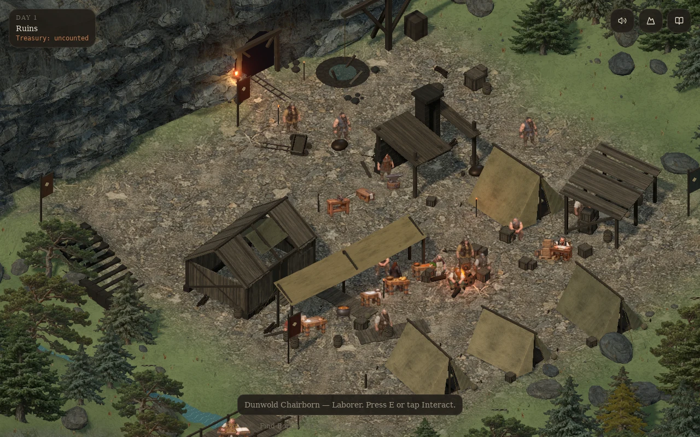
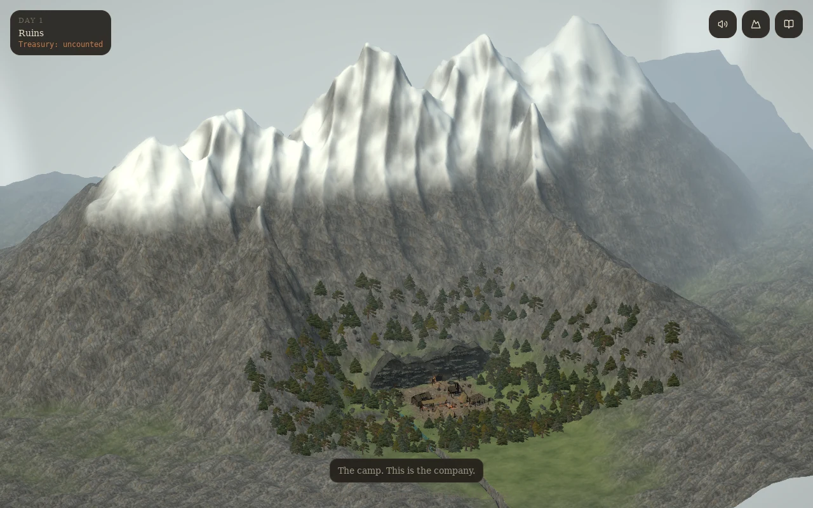
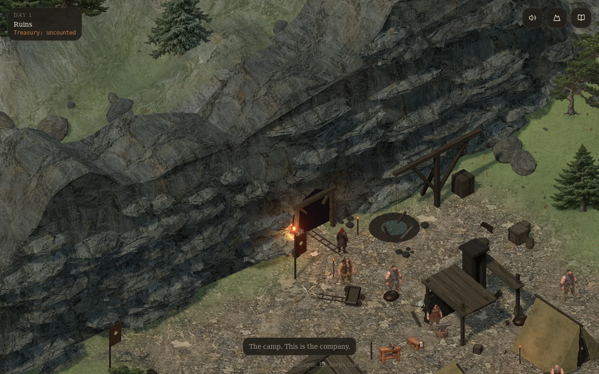
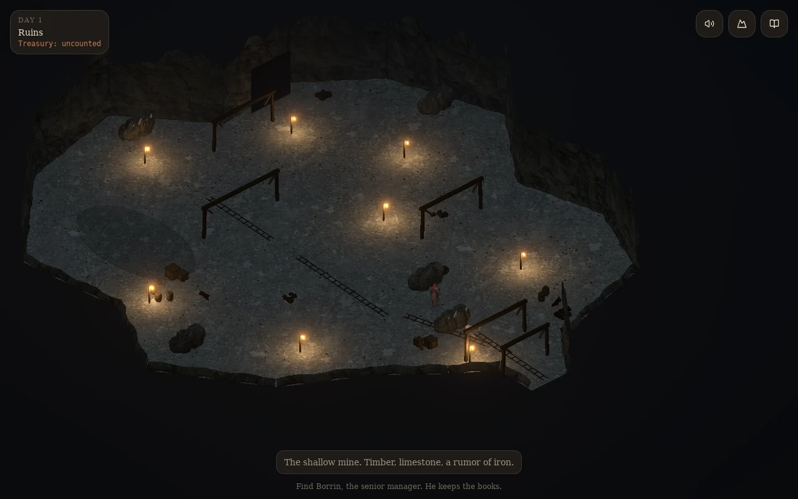

# The mountain expedition camp

The first stage now has a new settlement layout and full-size camp architecture: three guyed canvas sleeping tents, a larger ledger pavilion, a ruined timber barracks with exposed rafters, an open stone forge, covered stores, a canvas preparation shelter and a timber loading hoist. Broken roof sections, bedding, supplies, banners and tools make the clearing feel occupied before repairs begin.

The mountain foot is a continuous, fractured escarpment with a rough opening cut into the face. The primitive timber mouth and rail apron leave room for a later constructed gate. Beyond the camp, a connected alpine ridge rises above a mixed belt of spruce, fir, pine and larch. Packed slate earth, stone terraces, a creek and the timber crossing establish the base camp's surroundings.

## Explore

Walk north past the damaged cart and flooded shaft, then click the black mine opening or walk through it. The same simulation continues in a substantially larger, dark first chamber. Lantern pools mark the route past braced headings, rails, the original productive workstations, an abandoned supply bay, wet ground and deeper rock faces. Rotate with **Q/R** to inspect the cutaway walls. Camera-facing upper walls lower to keep workers visible.

Press **V** or the mountain button for the valley overview. Press it again to return to the player. Keyboard walking, wheel zoom and mobile controls remain available. Building clicks route to a clear approach; **E** inspects nearby structures. Brief interaction taps are buffered until the next render frame.

The rebuild applies to both a new ruins operation and a resumed camp. Old saved tent coordinates resolve to the new building approaches. Progress, condition, treasury and inventory stay in the existing save. The optional `/Dwarf-Lord-preview/` build uses a separate save slot.

## Construction and scope

`landscape.ts` shares terrain heights, the creek crossing, mine outline and navigable approaches between the renderer and movement. The expanded first level is about 2,500 square metres, with the three original mining destinations retained. Steep estate edges, creek banks and unexcavated rock bound movement.

The new architecture is authored geometry, with batched timber and stone parts and gently moving canvas. Two generated WebP assets add compacted alpine earth and four conifer species; prompts, dimensions, encodings and hashes are recorded beside them in `public/art`. The earlier bedrock material remains in use.

The existing character art, workstation roots, calibration, animation state machine and economic simulation are retained. New decorative ore faces do not add inventory or jobs. Gate construction, procedural excavation and additional mine levels remain future work.

## Validation and evidence

Run `npm test`, `npm run typecheck` and `npm run build:pages`. The layout tests cover every original mining destination, deep chamber round trips, bridge crossings, rock/water boundaries, level station foundations and all nine building approaches. Save tests check isolation of the optional preview and continuity of the main save slot.

After a static build, `node scripts/base-camp-playtest.mjs` exercises six routes through real game movement, a mouse click on the mine mouth, an E-key barracks inspection, all 22 workstation variants over six days, all 14 persistent stations, mobile overflow and resuming a camp with old tent coordinates. Set `WORLD_CHROMIUM` for an installed Chromium executable. `WORLD_REVIEW_MODE=visual` is a separate screenshot-only diagnostic and does not count as the full playtest.

`node scripts/base-camp-stride-playtest.mjs` retains the original lateral contact checker and bounds for three Blacksmith strides in each direction. `node scripts/revalidate-world-v2.mjs` rebinds changed world dependencies only after those checks pass. Earlier motion scopes, dates, approval flags, art and calibration remain unchanged; this does not approve unresolved animation work.

The current evidence is in [world-review/world-foundation-v2](world-review/world-foundation-v2). Earlier evidence remains in [world-review/base-camp-v1](world-review/base-camp-v1). Headless Chromium uses software rendering; these checks are not a hardware frame-rate benchmark.

