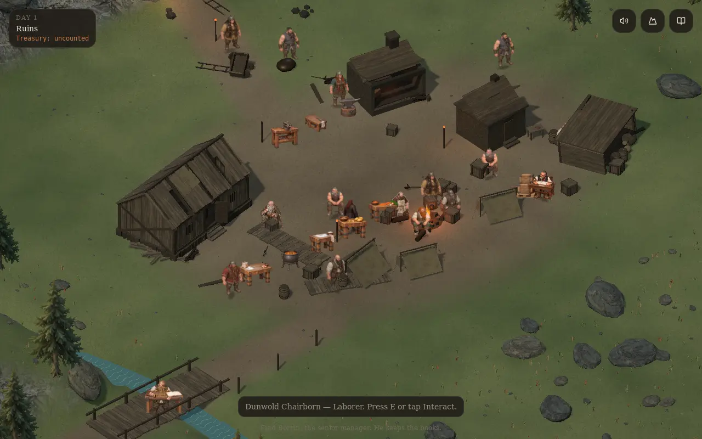
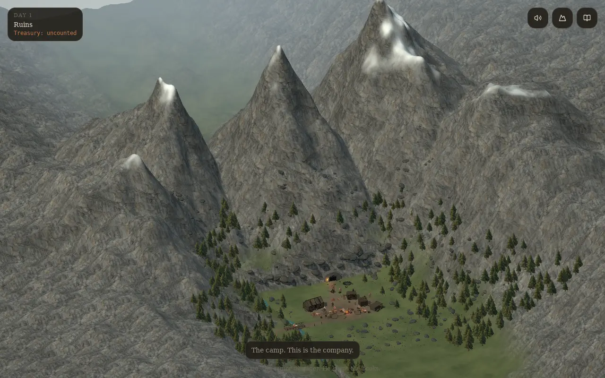
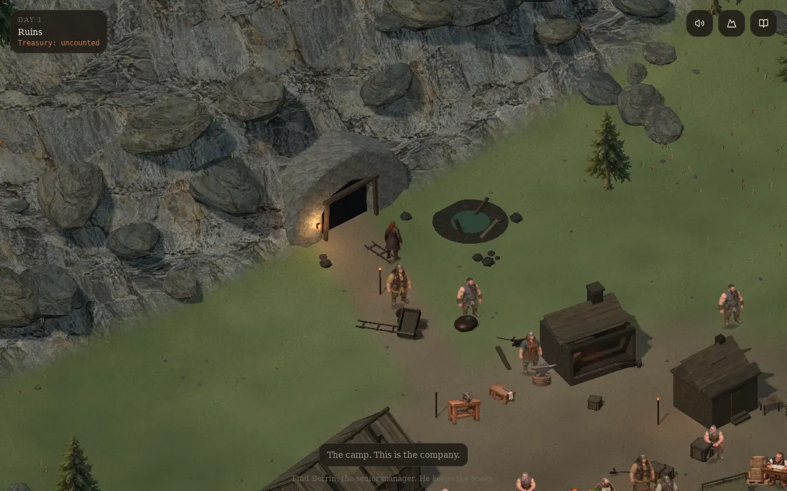
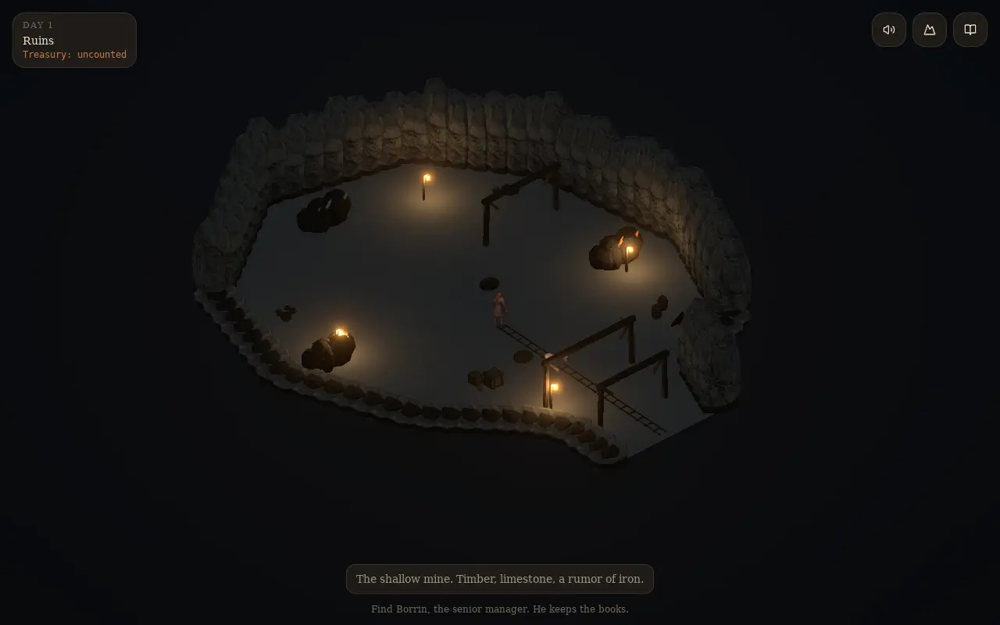

# Alpine base camp

The opening world follows the supplied references: a small, worn camp beneath a much larger alpine range, forested lower slopes and exposed rock above the tree line. The mine begins as a rough opening with timber bracing. Its first level is a dark, open working chamber with warm pools of lantern light.

## Play the new area

Walk around the existing dorm, tents, cookfire, forge, office and stores. Follow the worn northern approach past the cart and flooded shaft into the mountain. The existing limestone, iron and shaft-clearing jobs now occupy the first chamber. West of camp, the timber bridge carries the forestry route across the creek.

Press **V** or use the mountain button for the valley overview. Press it again to return to the player. **Q/R**, wheel zoom, keyboard walking and mobile controls retain their existing roles. The entrance has an open apron for a future constructed gate; gate construction is not added in this pass.

## World construction

- One continuous heightfield replaces the detached ground and background mountain pieces. Blended earth, meadow, exposed bedrock and high snow use world-space mapping. Seeded conifers, talus, small camp stones and grass keep the travel lanes and station aprons clear.
- `landscape.ts` defines the same creek, crossing, terrain heights and mine polygon for rendering and movement. Mine and forestry destinations route through the mouth and bridge. Steep estate edges, creek banks and unexcavated rock bound movement.
- Entering the adit switches to a cutaway chamber in the same simulation. Near walls lower with camera rotation; the exterior and its occupants hide while underground. Lighting and fog change with the layer.
- The chamber has rough walls, bracing, rail stubs, ore faces, salvage and supplies. Decorative ore and props do not create extra inventory or jobs. Procedural excavation, deeper levels and a constructed gate remain later work.
- Original actor roots, station calibration, task playback and economic simulation remain in place. The existing 22 independent workstation variants and 14 persistent props are rechecked through six game days.

## Validation

`node --test scripts/world-layout.test.mjs scripts/work-assignment.test.mjs` checks all mining destinations, return routes, bridge crossings, rock/water boundaries and level station foundations. `npm test`, `npm run typecheck` and `npm run build:pages` are the repository checks.

After a static build, run `node scripts/base-camp-playtest.mjs` with an installed Playwright Chromium. `WORLD_CHROMIUM` can select a compatible executable; `WORLD_REVIEW_OUTPUT` selects the evidence directory. The checker serves the actual Pages output, walks four routes with the game simulation, observes all 22 work variants finishing once on frame 7, checks all 14 persistent stations, and captures desktop/mobile views. Software-rendered QA is not a frame-rate benchmark.

Evidence lives in [world-review/base-camp-v1](world-review/base-camp-v1). The environment dependency audit preserves the earlier animation review dates, scopes, checks, art, calibration and approval flags. It does not approve unresolved gaits, hidden contact or additional animation families.

## New art

`public/art/alpine-spruce-v1.webp` is an alpha cutout generated with OpenAI's built-in image tool, then encoded as a 375,060-byte WebP for repeated forest instances. Its prompt, dimensions, encoding settings and SHA-256 are recorded in the adjacent JSON file. Existing character and workstation art is unchanged.

`public/art/alpine-bedrock-v1.webp` adds scanned-looking granite/slate fractures and mineral streaks to the mountain material. Its built-in generation prompt, encoding and SHA-256 are recorded alongside it.
